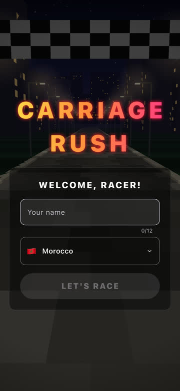
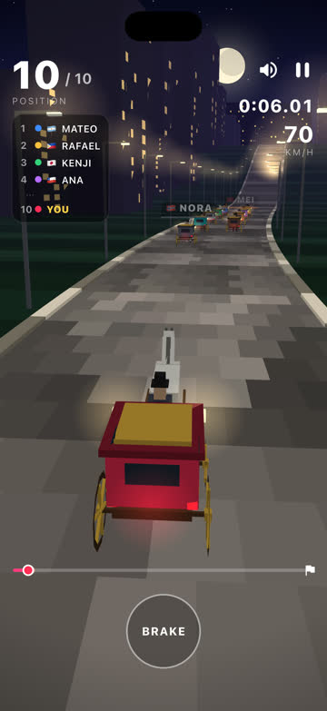
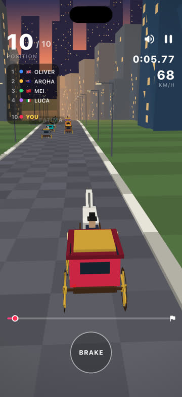
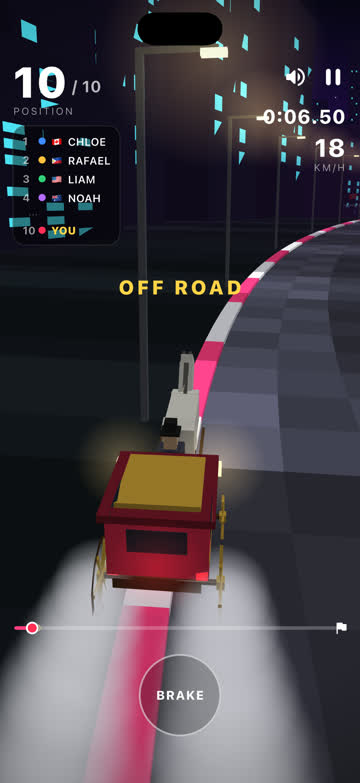
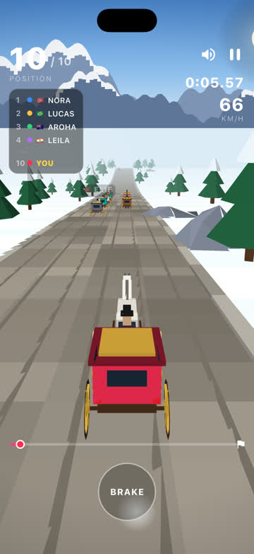
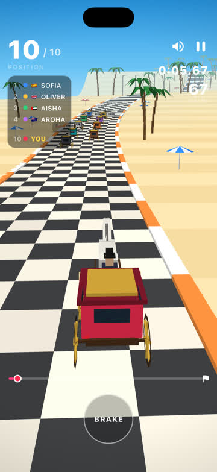

# Carriage Rush: Horse Race

A 3D horse-and-carriage racing game for Android and iOS, built with Flutter — **without a game engine**.
Race 9 rivals from around the world through eight famous places — from the cobbled boulevards of Paris at midnight to Tokyo's neon streets and the snowy Swiss Alps.

<p>
  
  
  
  
  
  
</p>

## Features
- **Your racer**: pick a name and your country on first launch; your flag rides with you.
- **You vs 9 AI rivals from around the world** — start last, finish first. Rivals change lanes, overtake and trade paint.
- **8 places**: Paris, London, New York, Tokyo, Dubai, Swiss Alps, Rio and Marrakech — each with its own light, road surface, scenery and sound.
- **Galloping horses** with animated legs, spoked carriage wheels, coachmen, lanterns at night.
- **Effects**: dust and sand off-road, debris when you hit rocks or palms, camera shake, haptics.
- **Sound**: hooves synced to your horse's cadence, the pack around you, crashes, whip cracks, fanfare, per-place ambience.
- **Touch controls**: hold the left/right half of the screen to steer, hold BRAKE to slow down.
- Best time and best place saved per course.
- **AdMob**: banner on menus, interstitial every 3rd race (never mid-race), opt-in rewarded ad to start from pole.

## How it works
- **Custom software 3D renderer** (`lib/game/painter3d.dart`): low-poly meshes are transformed, near-plane clipped, flat-shaded, fogged and depth-sorted every frame, then drawn in a few `Canvas.drawVertices` calls. Roughly 5–15k triangles in 2–6 ms.
- **Procedural models** (`lib/game/meshes.dart`): horses (8 gallop frames), carriages, carts, palms, pines, kasbahs, lamps, gantries.
- **Procedural tracks** (`lib/game/track.dart`): eased curves and hills turned into a real 3D centre line.
- **Synthesised audio** (`tool/make_sounds.py`): every sound effect is generated with numpy — no samples, no licensing.
- **Code-rendered artwork** (`tool/icon/render_icon_test.dart`): the app icon, adaptive icon layers and Play feature graphic are rendered from the game's own 3D models.

## Run it
```bash
flutter pub get
flutter run
```
Handy flags for testing:
```bash
flutter run --dart-define=AUTOSTART=true --dart-define=LOCATION=1   # jump straight into a race (0-7 = place)
flutter run --dart-define=SHOWFPS=true                               # frame time + triangle count
flutter run --dart-define=NOADS=true                                 # no consent form / ads (clean screenshots)
```

## Tests
```bash
flutter test test/widget_test.dart   # UI, race rules, sounds, collisions
flutter test test/balance_sim.dart   # an autopilot races every course and prints the result
```

## Regenerate assets
```bash
python3 tool/make_sounds.py                                   # sounds -> assets/sfx/
flutter test tool/icon/render_icon_test.dart && dart run flutter_launcher_icons   # icons
```

## Release
See [RELEASE.md](RELEASE.md) for AdMob setup, signing and the Google Play checklist.
Real ad unit IDs are passed at build time with `--dart-define`; the repo only contains Google's public test IDs.

